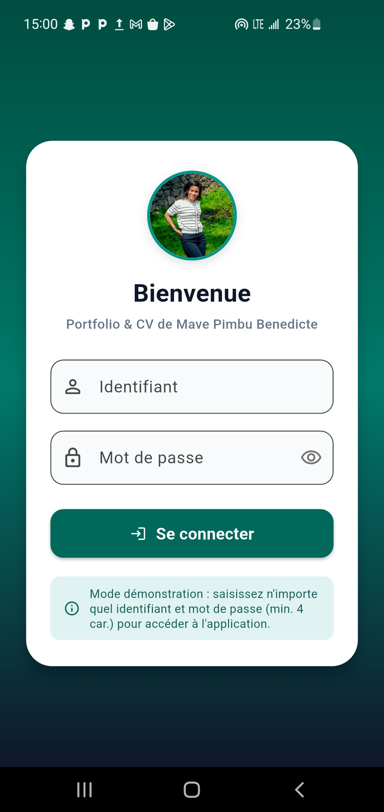
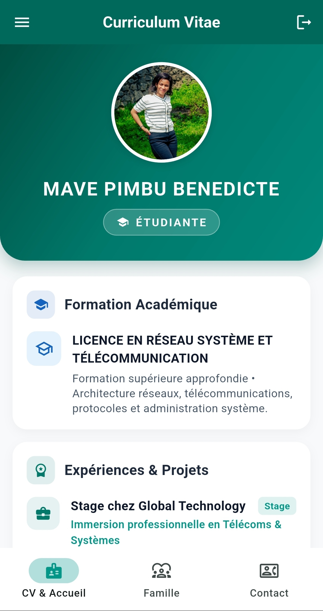
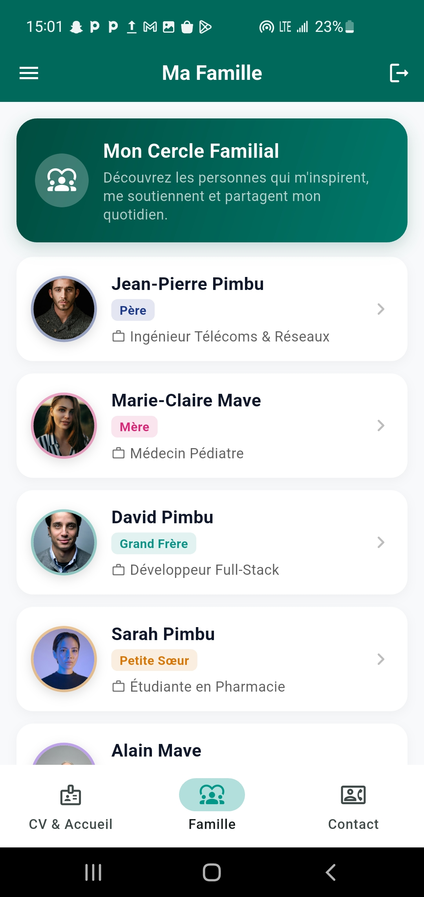
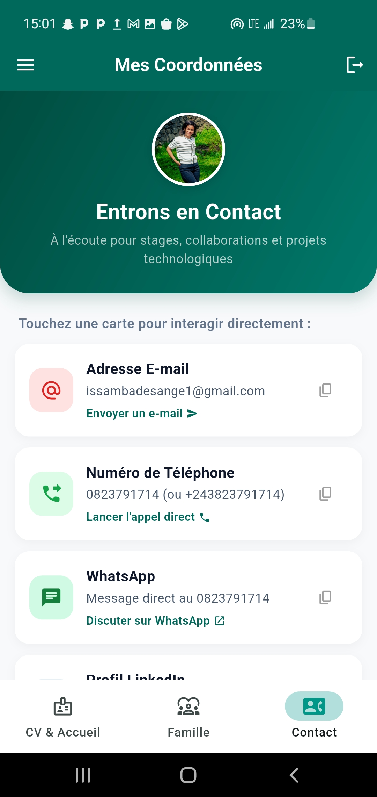
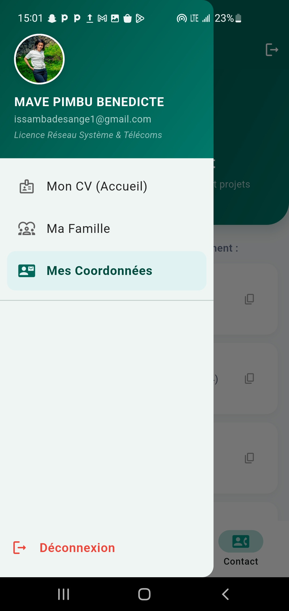
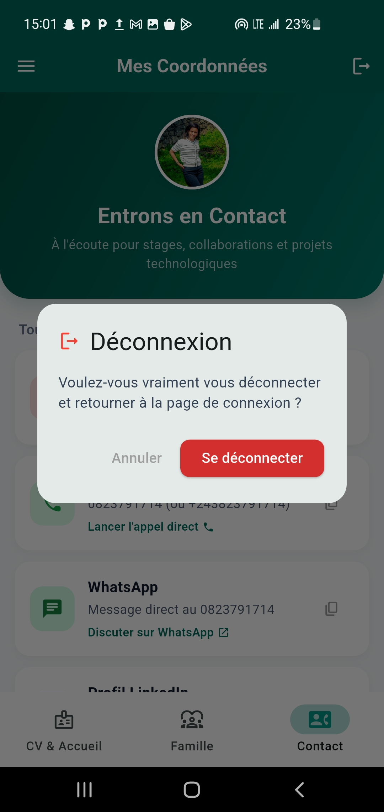

# CV Mobile Flutter - MAVE PIMBU BENEDICTE

Application mobile moderne développée avec **Flutter** présentant le profil professionnel, le parcours académique, le cercle familial et les coordonnées de **MAVE PIMBU BENEDICTE**.

---

## 📱 Aperçu des Écrans

<div align="center">

| Page de Connexion | Menu & Navigation | Mon CV (Accueil) |
| :---: | :---: | :---: |
|  |  |  |

| Cercle Familial | Détail Famille | Coordonnées & Contact |
| :---: | :---: | :---: |
|  |  |  |

</div>

---

## ✨ Fonctionnalités Principales

### 1. Authentification (`LoginScreen`)
- Formulaire d'accès avec identifiant et mot de passe masqué (affichage basculable).
- Validation des champs avec messages d'erreur clairs.
- Transition fluide et notification de bienvenue.

### 2. Mon Curriculum Vitae (`CvScreen`)
- Photo de profil réelle et présentation du statut : **ÉTUDIANTE**.
- **Formation académique** : Licence en Réseau Système et Télécommunication.
- **Expériences & Projets** :
  - Stage en entreprise chez **Global Technology**.
  - Conception et réalisation d'une **Application de gestion d'un hôpital**.
- **Compétences techniques** : Flutter, Développement Web, Réseaux & Télécoms, Dart.
- **Langues** : Français, Lingala, Swahili.
- **Centres d'intérêt** : Jeux de réflexion, Recherches technologiques, Lecture.

### 3. Cercle Familial (`FamilyScreen`)
- Présentation soignée des membres sous forme de cartes interactives (`Card`, `ListView`).
- Photos individuelles avec gestion automatique des replis hors-ligne (`AppAvatar`).
- Fiche de détails contextuelle pour chaque membre de la famille au toucher (`ModalBottomSheet`).

### 4. Mes Coordonnées (`ContactScreen`)
- Actions interactives directes via `url_launcher` :
  - **E-mail** : `issambadesange1@gmail.com`
  - **Téléphone** : `0823791714`
  - **WhatsApp** : discussion instantanée
  - **LinkedIn** & **GitHub** : profils professionnels
- Bouton de copie rapide dans le presse-papiers pour chaque contact.

### 5. Double Navigation Ergonomique
- **NavigationBar** inférieure Material 3.
- **Drawer** latéral complet avec photo de profil et bouton de déconnexion.

---

## 🛠️ Stack Technique

- **Framework** : Flutter 3
- **Langage** : Dart
- **Design System** : Material Design 3
- **Dépendances** :
  - `url_launcher` : gestion des ouvertures d'appels, e-mails et URLs web.
  - `cupertino_icons` : icônes complémentaires.

---

## 🚀 Installation et Lancement

1. Cloner le dépôt :
```bash
git clone https://github.com/votre-compte/cv_flutter_mave_pimbu_bene.git
cd cv_flutter_mave_pimbu_bene
```

2. Récupérer les dépendances :
```bash
flutter pub get
```

3. Lancer l'application :
```bash
flutter run
```
